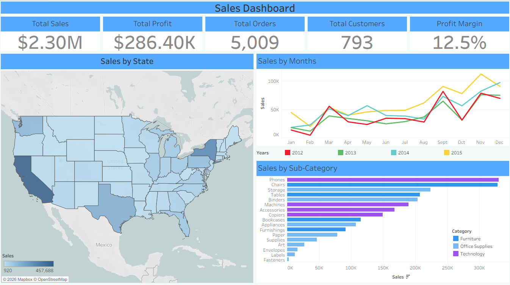
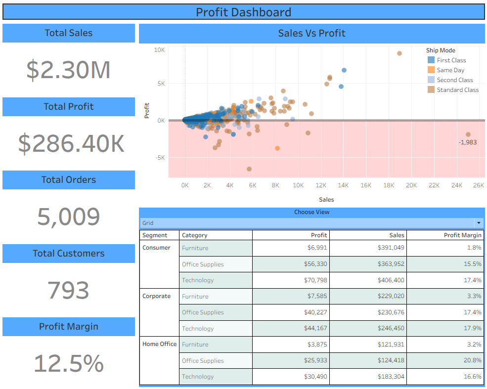
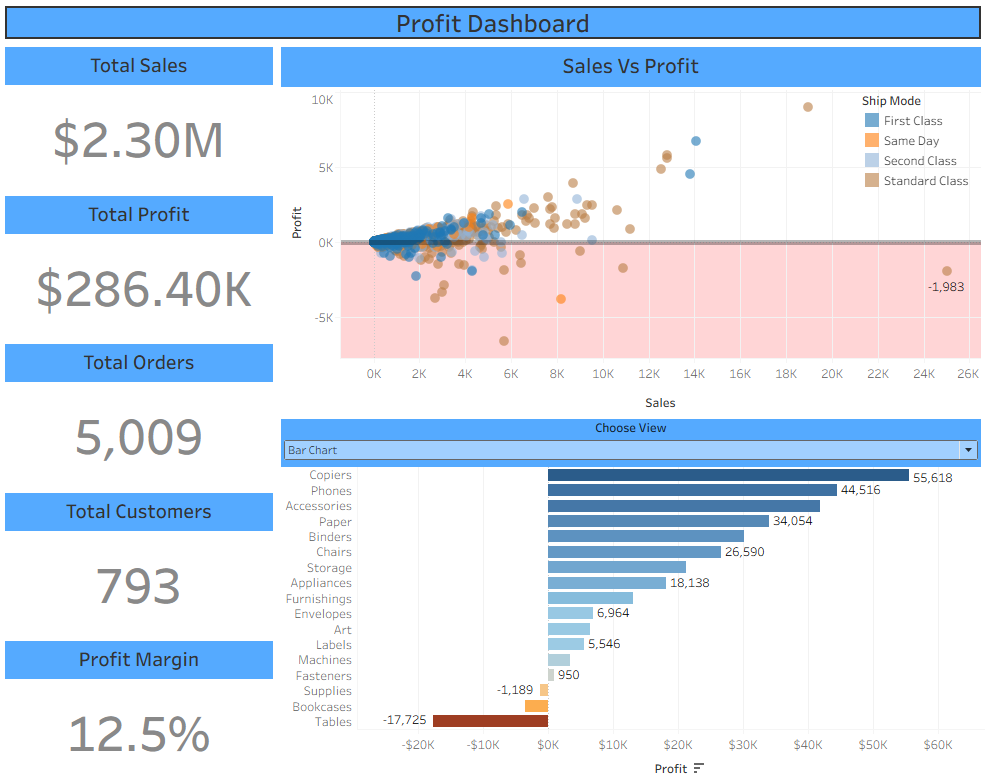

<h1 align="center">Superstore Sales & Profit Dashboard</h1>

  <b>Where does the money come from, and where does it quietly leak away?</b> 
  An end-to-end Tableau analysis of 9,994 order lines (2012-2015) built to find what drives profit, and what destroys it.

  
  
  
  
  

---

## Table of Contents

1. [Project at a Glance](#project-at-a-glance)
2. [Purpose and Aim](#purpose-and-aim)
3. [The Dataset](#the-dataset)
4. [How to Read the Dashboards](#how-to-read-the-dashboards)
5. [Dashboard 1: Sales Overview](#dashboard-1-sales-overview)
6. [Dashboard 2: Profit Dashboard](#dashboard-2-profit-dashboard)
7. [What Drives Profit: Factors That Help and Hurt](#what-drives-profit-factors-that-help-and-hurt)
8. [Key Findings](#key-findings)
9. [Recommendations](#recommendations)
10. [Limitations and Next Steps](#limitations-and-next-steps)
11. [Repository Contents](#repository-contents)
12. [Tools and Skills](#tools-and-skills)
13. [Author](#author)

---

## Project at a Glance

| | |
|---|---|
| **Business** | A US retailer selling Furniture, Office Supplies and Technology to Consumer, Corporate and Home Office customers |
| **Period** | January 2012 to December 2015 |
| **Scale** | 9,994 order lines, 5,009 orders, 793 customers, 1,862 products, 4 US regions |
| **Total sales** | about **\$2.30M** |
| **Total profit** | about **\$286K** |
| **Profit margin** | **12.5%** |
| **Headline result** | Sales and profit grew every year after a small 2013 dip, but **deep discounts and a few weak product lines silently cost about \$156K in losses** |
| **Deliverables** | 2 interactive Tableau dashboards, a Tableau workbook and this documentation |

> [!NOTE]
> The dashboards were built in Tableau Desktop and are not hosted publicly (public hosting is paid). Screenshots of every view are included below, and the workbook (`.twb`) is in this repository for anyone who has Tableau.

---

## Purpose and Aim

### The problem
Sales are the number most people watch, but sales alone can mislead. A product can sell very well and still lose money. This project asks a harder question than "how much did we sell?": **"how much of what we sold was actually worth selling?"**

### The aim
Build a clear, user-friendly dashboard that lets anyone, including a non-technical reader, understand:
1. **How big** the business is and how it is growing.
2. **Where and when** sales happen.
3. **What earns profit** and what destroys it.
4. **Which factors** explain the difference, so a decision maker knows what to change.

### Objectives
| # | Objective | Answered by |
|---|---|---|
| 1 | Summarise overall business health in five numbers | KPI row (Figure 1) |
| 2 | Find the strongest and weakest markets | Sales by State map (Figure 2) |
| 3 | Detect seasonality and year-on-year growth | Sales by Months (Figure 3) |
| 4 | Rank products by revenue | Sales by Sub-Category (Figure 4) |
| 5 | Check whether bigger sales bring bigger profit | Sales vs Profit scatter (Figure 5) |
| 6 | Compare margin across customer segments and categories | Grid view (Figure 6) |
| 7 | Separate profit-makers from profit-losers | Profit by Sub-Category (Figure 7) |

### What "success" looks like (the achievement factors)
A healthy retail business needs three things to hold at the same time. Every chart in this project tests one of them:

| Success factor | Question asked | Measure used |
|---|---|---|
| **Growth** | Are sales rising year after year? | Sales by year and month |
| **Profitability** | Is each dollar of sales earning a healthy return? | Profit margin (Profit / Sales) |
| **Efficiency** | Is any activity costing more than it brings in? | Loss-making products, states and discount levels |

The result: **growth is strong, profitability is healthy overall, but efficiency is the weak link**. Most of the leakage traces back to a small number of causes, covered in [What Drives Profit](#what-drives-profit-factors-that-help-and-hurt).

---

## The Dataset

**Source:** Sample - Superstore (Excel), a widely used practice dataset for retail analytics.

| Sheet | Content |
|---|---|
| **Orders** | 9,994 order lines with 21 columns: dates, ship mode, customer, segment, location, product, category, sub-category, sales, quantity, discount and profit |
| **Returns** | 296 returned orders |
| **People** | The four regional managers (West, East, Central, South) |

**Data quality checks:** no missing values and no duplicate rows.

**Metric definitions used in the dashboards**

| Metric | Definition |
|---|---|
| Total Sales | Sum of Sales |
| Total Profit | Sum of Profit |
| Profit Margin | Sum of Profit / Sum of Sales |
| Total Orders | Distinct count of Order ID (not row count, because one order can have several lines) |
| Total Customers | Distinct count of Customer ID |

> [!NOTE]
> All time-based charts use **Order Date**. The Returns and People sheets are not charted in the dashboards; the effect of returns is discussed in the factors section from supplementary analysis.

---

## How to Read the Dashboards

- **Colour has one meaning per chart.** On the map, darker blue means higher sales. On the bar chart, blue means profit and orange means loss.
- **Hover** over any state, dot or bar to see exact values.
- **Choose View** (Dashboard 2): use the drop-down to switch the lower panel between a **Grid** (exact numbers by segment and category) and a **Bar Chart** (profit ranking by sub-category).
- **Pink area** on the scatter plot is the loss zone. Anything below the dark zero line lost money.
- **KPI cards** are the same on both dashboards, so the headline numbers are always in view.

---

## Dashboard 1: Sales Overview

### Figure 1: KPI Summary Row
- **What it shows:** Total Sales, Total Profit, Total Orders, Total Customers and Profit Margin.
- **Objective:** Give the reader the overall result before any chart.
- **Insight:** The business made about **\$2.30M in sales** and **\$286K in profit** at a **12.5% margin**. Across **5,009 orders** from **793 customers**, the average customer placed about **6 orders** worth about **\$2,900** in total, and the average order was worth about **\$459**.

### Figure 2: Sales by State (filled map)
- **What it shows:** Each US state shaded by total sales. Darker blue means higher sales (legend runs from about \$920 to about \$458K).
- **Objective:** Find the strongest markets and the regions with little activity.
- **Insight:** California is the largest market by far (about \$458K), followed by New York (about \$311K), Texas (about \$170K), Washington (about \$139K) and Pennsylvania (about \$117K). **The top five states make up about 52% of all sales.** Large parts of the Mountain West and the Plains contribute very little.
- **Watch out:** A dark state is not necessarily a profitable one. See the factors section for Texas.

### Figure 3: Sales by Months (line chart)
- **What it shows:** Monthly sales, one line per year: 2012 (red), 2013 (green), 2014 (teal) and 2015 (yellow).
- **Objective:** Reveal seasonality and check whether each year beat the last.
- **Insight:**
  - **September, November and December together produce about 43% of annual sales.** February is the weakest month at about 2.6%.
  - 2015 sits above the other years in most months, peaking at about \$112K in November.
  - Annual sales went from about \$484K (2012) to about \$734K (2015), up about 52%, with a small dip in 2013.

### Figure 4: Sales by Sub-Category (bar chart)
- **What it shows:** Total sales for each of the 17 sub-categories, coloured by parent category.
- **Objective:** Rank products by revenue.
- **Insight:** Phones (about \$330K) and Chairs (about \$328K) lead, followed by Storage, Tables and Binders. Fasteners, Labels and Envelopes contribute very little.
- **Important:** High sales do not mean high profit. Tables is the fourth-biggest seller and loses money (see Figure 7).

---

## Dashboard 2: Profit Dashboard

The same five KPI cards run down the left side. The right side has a scatter plot above a **Choose View** drop-down that switches between a Grid and a Bar Chart.

### Figure 5: Sales vs Profit (scatter plot)

- **What it shows:** Each dot is a sale record, placed by sales (horizontal) and profit (vertical). Colour shows ship mode: First Class (dark blue), Same Day (orange), Second Class (light blue) and Standard Class (tan). The dark line marks zero profit and the pink area below it is the loss zone.
- **Objective:** Test whether bigger sales bring bigger profit and spot unusual transactions.
- **Insight:**
  - Most transactions are small and cluster near the origin.
  - Profit rises with sales on the whole, but not reliably. Several large sales (above \$5K) land in the pink area, and the largest sale in the chart, about \$25K, **lost about \$1,983** (labelled on the chart).
  - Standard Class is the most common ship mode (about 59% of sales), so it appears in most points, including the losses.

### Figure 6: Segment and Category table (Choose View = Grid)
- **What it shows:** Profit, Sales and Profit Margin for every combination of customer segment and category.
- **Objective:** Compare exact numbers across segments and categories in one place.
- **Insight:**
  - **Technology and Office Supplies earn margins of about 15% to 21%** in every segment. Home Office Office Supplies is the highest at 20.8%.
  - **Furniture earns only 1.8% to 3.3%** in every segment, though its sales are similar to the other categories. Consumer Furniture makes about \$7.0K profit on \$391K of sales (1.8%).
  - Consumer is the biggest segment (about 51% of sales), but Home Office earns the best margin.

### Figure 7: Profit by Sub-Category (Choose View = Bar Chart)

- **What it shows:** Total profit per sub-category, sorted high to low. Blue bars are profitable and orange bars are loss-making.
- **Objective:** Identify which products create profit and which destroy it.
- **Insight:**
  - **Copiers** lead at about \$55.6K, then Phones (\$44.5K), Accessories, Paper and Binders.
  - **Tables (about -\$17.7K), Bookcases (about -\$3.5K) and Supplies (about -\$1.2K) lose money.**
  - Compare with Figure 4: Tables sells a lot and still loses money. Revenue alone gives a misleading picture.

---

## What Drives Profit: Factors That Help and Hurt

This is the core of the analysis. Seven factors were tested. **Discounting is by far the most powerful**, followed by product mix and geography.

### Factor 1: Discount level (the biggest driver)

| Discount given | Order lines | Sales | Profit | Margin |
|---|---:|---:|---:|---:|
| None | 4,798 | \$1,088K | **+\$321K** | **29.5%** |
| Up to 20% | 3,803 | \$847K | +\$101K | 11.9% |
| 20% to 40% | 460 | \$234K | -\$36K | -15.3% |
| 40% to 60% | 215 | \$71K | -\$29K | -40.7% |
| Above 60% | 718 | \$58K | -\$71K | -122.6% |

- **Lines sold with no discount earned \$321K, more than the whole company's \$286K profit.** Every discounted line above 20% combined lost about \$135K.
- **1,871 order lines (18.7%) lost money, about \$156K in total. 98.9% of them carried a discount of 20% or more.**
- Above about 20%, a discount is no longer a price cut; it is a loss on every sale.

### Factor 2: Product mix (what you sell)

| Category | Sales | Profit | Margin | Margin when not discounted | Margin when discounted |
|---|---:|---:|---:|---:|---:|
| Technology | \$836K | \$145K | 17.4% | 34.0% | 2.9% |
| Office Supplies | \$719K | \$122K | 17.0% | 29.5% | -2.9% |
| Furniture | \$742K | \$18K | **2.5%** | 22.7% | **-8.2%** |

- **Furniture is the clearest weak spot.** Undiscounted, it earns a healthy 22.7%. Discounted, it loses 8.2%. Since 65% of Furniture sales are discounted, almost all its profit disappears.
- **Tables** carries an average discount of 26% and **64% of its order lines lose money.** Without discounts it earned about \$13K; with discounts of 20% or more it lost about \$31K.
- **Bookcases** (21% average discount) and **Machines** (31% average discount, only 1.8% margin) show the same pattern.
- **Supplies** loses money despite a low discount (7.7%), so its problem is cost or pricing, not discounting.
- **Best performers:** Copiers (37% margin, no loss-making lines), Paper (43%, no loss-making lines), Phones, Accessories and Labels.

### Factor 3: Geography (where you sell)

| State | Average discount | Profit | Margin |
|---|---:|---:|---:|
| Texas | 37% | -\$25.7K | -15.1% |
| Ohio | 32.5% | -\$17.0K | -21.7% |
| Pennsylvania | 33% | -\$15.6K | -13.4% |
| Illinois | 39% | -\$12.6K | -15.7% |
| California | 7% | +\$76.4K | 16.7% |
| New York | 5.5% | +\$74.0K | 23.8% |

- Four large states lose money despite healthy sales. In every one, **100% of order lines were discounted at an average of 33% to 39%**. The two top profit states discount far less.
- **By region:** West earns a 14.9% margin with a 10.9% average discount. **Central earns only 7.9% with a 24% average discount**, and 32% of its order lines are loss-making (West: 10%).

### Factor 4: Seasonality (when you sell)
- **43% of annual sales land in September, November and December.** February is only 2.6%.
- The business is exposed to a few key months. A stock shortage, delay or promotion mistake in Q4 would hit the whole year.

### Factor 5: Customer segment (who buys)
| Segment | Share of sales | Margin |
|---|---:|---:|
| Consumer | 50.6% | 11.5% |
| Corporate | 30.7% | 13.0% |
| Home Office | 18.7% | 14.0% |

- The largest segment earns the lowest margin. The effect is modest compared with discounting and product mix.

### Factor 6: Shipping mode (how you deliver)
| Ship mode | Share of sales | Margin |
|---|---:|---:|
| Standard Class | 59.1% | 12.1% |
| Second Class | 20.0% | 12.5% |
| First Class | 15.3% | 13.9% |
| Same Day | 5.6% | 12.4% |

- **Shipping mode has little effect on profit.** All four modes earn between 12% and 14%. The scatter plot's losses are explained by discounts and products, not by how the order was shipped.

### Factor 7: Returns
- **296 orders (5.9%) were returned**, covering about \$181K of sales (7.9%) and about \$23K of profit.
- The dashboard totals include these orders, so true net performance is slightly lower than shown.

### Factors at a glance
| Factor | Strength of effect on profit | Direction |
|---|---|---|
| Discount level | Very strong | Higher discount, lower profit; losses start above about 20% |
| Product mix | Strong | Technology and Office Supplies earn; Furniture, Machines and Tables do not |
| Geography | Strong | Driven mainly by how heavily each state is discounted |
| Seasonality | Moderate (affects timing) | Q4 carries the year |
| Customer segment | Mild | Consumer has the lowest margin |
| Returns | Mild | About 8% of sales reversed |
| Ship mode | Negligible | All modes earn 12% to 14% |

---

## Key Findings

1. **The business is growing.** Sales rose from about \$484K to about \$734K (2012 to 2015) and profit nearly doubled from about \$49.5K to about \$93.5K. The margin improved from 10.2% to a steady 12% to 13%.
2. **Profit growth has levelled off.** Margin was about 13.4% in 2014 and 12.7% in 2015, so sales are growing faster than profit.
3. **Discounting is the single biggest profit killer.** No-discount sales earn 29.5%, while any discount above 20% loses money.
4. **Technology and Office Supplies carry the business.** Both earn about 17%. Furniture earns 2.5%.
5. **Three sub-categories lose money:** Tables, Bookcases and Supplies. Machines is almost break-even.
6. **High sales do not equal high profit.** Texas, Ohio, Pennsylvania and Illinois sell well and still lose money.
7. **The Central region is the weakest** (7.9% margin) and has the heaviest discounting.
8. **Sales are concentrated** in a few states (top five = 52%) and a few months (Sep, Nov, Dec = 43%).
9. **Shipping mode barely matters** for profit.

---

## Recommendations

| Priority | Action | Why (evidence) | Illustrative upside |
|---|---|---|---|
| 1 | **Cap discounts at about 20%** and require approval above that | Every discount above 20% lost money; 98.9% of loss-making lines carried 20% or more | If discounted lines above 20% had only broken even, profit would rise by up to about \$135K (about 47%) |
| 2 | **Reprice or rework Tables, Bookcases and Machines** | Heavily discounted, with 64%, 48% and 38% of lines loss-making | Removes about \$21K of direct losses from Tables and Bookcases, and lifts Machines out of near-zero margin |
| 3 | **Investigate Supplies pricing and cost** | Loses money with only 7.7% average discount | Cost or price issue, not a discount issue |
| 4 | **Audit discount practice in Texas, Ohio, Pennsylvania, Illinois and the Central region** | Average discounts of 33% to 39% and negative margins | Bringing the four loss-making states to break-even would add about \$71K |
| 5 | **Grow Technology, especially Copiers, Phones and Accessories** | Highest margins with few or no loss-making lines | Protects and grows the profit base |
| 6 | **Plan around Q4** and lift the weak months | 43% of sales in three months; February at 2.6% | Smoother cash flow and lower risk |
| 7 | **Track returns** | 5.9% of orders and 7.9% of sales reversed | Better net-profit visibility |

> [!NOTE]
> "Illustrative upside" figures are simple upper-bound calculations from this dataset, not forecasts.

---

## Limitations and Next Steps

- **Correlation is not proof of cause.** Deeply discounted products may also have weaker margins for other reasons. The pattern is strong enough to act on, but a controlled test (for example capping discounts in one region) would confirm it.
- **Sample data.** Superstore is a practice dataset, so the business conclusions are for demonstration.
- **Profit is as supplied.** No cost-of-returns or overhead adjustment has been made.
- **Next steps:** add a Discount vs Profit view to the dashboard, and add a Year filter so readers can explore one period at a time.

---

## Repository Contents

| File | Description |
|---|---|
| `README.md` | This documentation |
| `1. Sample - Superstore.xls` | Source dataset (Orders, Returns, People) |
| `Sales n Profit DB.twb` | Tableau workbook with both dashboards (open in Tableau; you may need to re-point it to the data file) |
| `dashboard-1-sales-overview.png.png` | Screenshot of Dashboard 1: Sales Overview |
| `dashboard-2-profit-grid.png.png` | Screenshot of Dashboard 2 in Grid view |
| `dashboard-2-profit-bar.png.png` | Screenshot of Dashboard 2 in Bar Chart view |

---

## Tools and Skills

- **Tableau:** KPI cards, calculated fields, filled map, line and bar charts, scatter plot with reference lines, parameter-driven view switch, dashboard layout and formatting
- **Microsoft Excel:** source data and validation
- **Analysis skills:** data cleaning checks, profit and margin analysis, driver analysis, business storytelling and dashboard design

---

## Author

**Ayush Denzil Tirkey**
PGDM (Human Resources Management), XISS Ranchi
GitHub: [@AyzusD](https://github.com/AyzusD)

Feedback and suggestions are welcome. If you found this useful, a star on the repository is appreciated.
